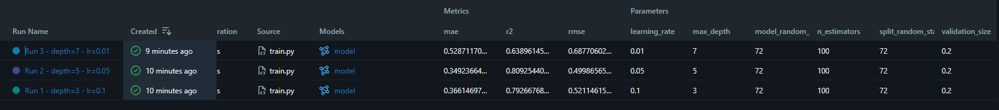
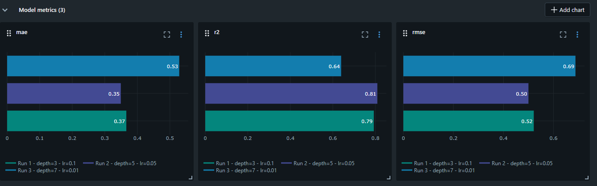

# Exploring MLflow for Experiment Tracking

## Why I wanted to explore this

One thing I learned from working on machine learning projects is that training a model is not always the hardest part. Sometimes, the difficult part comes later, when you have several experiments, different configurations, and a repository full of code and results, but no clear way to connect everything together.

I experienced this in a previous project that we worked on for around a month or two. As the work progressed, keeping track of everything became increasingly difficult. It was not always clear which parameters had been used, what a particular experiment was testing, where its results were stored, or which model had produced them. Finding the relevant files and reconstructing what we had done could become a task in itself.

That experience made me think more seriously about how we organize machine learning experiments. In our graduation project, where we expect to work with multiple baselines and many experiments, we started defining repository rules and conventions for organizing experiments and runs. The idea was to make each experiment understandable and traceable, rather than relying on memory or trying to reconstruct our decisions later.

Interestingly, these ideas started developing independently of any particular experiment-tracking platform. We were thinking about how to structure our work and what information should be recorded before we learned more about tools such as MLflow.

This assignment is separate from my graduation project, but it came at a time when the problem was already relevant to me. Exploring MLflow gave me an opportunity to understand how a dedicated platform can support many of the practices we were trying to establish ourselves.

## What this project does

The task was to train a regression model on the California Housing dataset using three different hyperparameter configurations, track the experiments with MLflow, and select the best-performing model.

I used `GradientBoostingRegressor` and varied two hyperparameters: `max_depth` and `learning_rate`. I kept the model family the same across all three runs so that I could compare the configurations under a consistent setup.

The dataset was split into 80% training data and 20% validation data, using a fixed random seed of `42`. All configurations used the same split, and the number of estimators was fixed at 100.

The three configurations were:

| Run   | Max Depth | Learning Rate |
| ----- | --------: | ------------: |
| Run 1 |         3 |           0.1 |
| Run 2 |         5 |          0.05 |
| Run 3 |         7 |          0.01 |

The goal was not to search for every possible combination of hyperparameters. It was to work with the configurations specified by the task and understand how to record, compare, and evaluate the resulting experiments.

## Learning to use MLflow

Before this task, I had no practical experience with MLflow, including its tracking concepts and UI. I was familiar with training and evaluating machine learning models, but the experiment-management side was new to me.

I used MLflow Tracking to organize the three runs under one experiment named `California Housing - Gradient Boosting`. For each run, I logged the hyperparameters, validation metrics, and trained model artifact.

I also configured a local SQLite database as the tracking backend and used the MLflow UI to inspect the recorded experiments.

What interested me was the connection between these pieces. The parameters explain how a model was configured, the metrics describe how it performed, and the model artifact preserves the trained model itself. Keeping these together makes it easier to move from a result to the experiment that produced it.

This does not mean that a tracking platform replaces good repository organization or clear experiment definitions. Those practices still matter. What MLflow adds is a structured place to record and inspect much of the information that would otherwise be scattered across terminal output, files, and personal notes.

That distinction is particularly relevant to the problems I had encountered before. Instead of trying to remember what I did several weeks ago, I can inspect a recorded run and understand its configuration and results.

## Comparing the experiments

After training the three configurations, I compared their performance on the same validation set using RMSE, MAE, and R².

| Run   | Max Depth | Learning Rate |    RMSE |     MAE |      R² |
| ----- | --------: | ------------: | ------: | ------: | ------: |
| Run 1 |         3 |           0.1 | 0.52115 | 0.36615 | 0.79267 |
| Run 2 |         5 |          0.05 | 0.49987 | 0.34924 | 0.80925 |
| Run 3 |         7 |          0.01 | 0.68771 | 0.52871 | 0.63896 |

RMSE was the primary metric for model selection, as required by the task. Lower RMSE indicates smaller prediction errors, with larger errors having a stronger effect on the metric. MAE provides another measure of the size of prediction errors, while R² gives an indication of how the model performs relative to a mean-prediction baseline.

### What I found

Run 2 achieved the best results across all three metrics. Compared with Run 1, it had a lower RMSE and MAE and a higher R².

Run 3 performed considerably worse, even though it used the greatest tree depth. Its combination of a deeper tree and a lower learning rate did not translate into better validation performance.

This was a useful reminder that making a model more complex or changing a hyperparameter in what seems like a promising direction does not guarantee an improvement. The effect depends on the configuration and the problem being solved.

These results do not establish that Run 2 is the best possible configuration for the dataset. They show that it performed best among the three configurations tested under this particular experimental setup. That distinction matters because experiment tracking should help us understand the evidence we have, rather than encourage conclusions that go beyond it.

## Viewing the results in MLflow

One of the most useful parts of the task was moving from terminal output to the MLflow UI. Instead of collecting the results manually, I could inspect the runs together and compare the logged parameters and metrics.

### MLflow runs table

The runs table provides a direct comparison of the three configurations and their validation performance.



### Metric comparison plots

The metric plots provide another view of the same results, making it easier to compare the three runs across RMSE, MAE, and R².



## Selecting the final model

Based on the validation results, I selected **Run 2**, with `max_depth=5` and `learning_rate=0.05`.

It achieved the lowest RMSE of `0.49987`, the lowest MAE of `0.34924`, and the highest R² of `0.80925` among the configurations tested.

The decision was based on measured validation performance rather than assumptions about which hyperparameters should work best. Run 2 was the strongest configuration in this comparison, although further experiments would be needed to investigate whether other settings could produce better results.

## Running the project

The project uses Python, scikit-learn, and MLflow. The training script handles dataset loading, splitting, model training, evaluation, experiment tracking, and model logging.

### 1. Create a virtual environment

On Windows, open PowerShell in the project directory and run:

```powershell
py -3.13 -m venv .venv
.\.venv\Scripts\Activate.ps1
```

### 2. Install the dependencies

```powershell
python -m pip install --upgrade pip
pip install -r requirements.txt
```

### 3. Run the experiments

```powershell
python train.py
```

The script trains all three configurations, records their parameters and metrics in MLflow, saves the trained models, and prints a comparison table with the selected configuration.

The California Housing dataset may need to be downloaded on the first run if it is not already cached locally.

### 4. Open the MLflow UI

In a separate PowerShell terminal, navigate to the project directory and run:

```powershell
mlflow server --backend-store-uri "sqlite:///mlflow.db" --host 127.0.0.1 --port 5000
```

Then open http://127.0.0.1:5000 in your browser and navigate to the `California Housing - Gradient Boosting` experiment.

From there, you can inspect individual runs, compare their parameters and metrics, and access their logged model artifacts.

## Project structure

```text
mlflow-task/
├── train.py
├── requirements.txt
├── README.md
├── .gitignore
└── screenshots/
    ├── mlflow-runs-table.png
    └── mlflow-metrics-plots.png
```

## What I am taking away from this

The main thing I wanted to understand through this task was how experiment tracking fits into the machine learning workflow beyond simply training and evaluating a model.

My previous experience had already shown me how difficult it can become to maintain a clear record of experiments as a project grows. Learning MLflow gave me a practical example of how a dedicated tracking platform can help address that problem by connecting configurations, metrics, and model artifacts in one place.

I also see a clear connection to the way we are preparing to organize experiments in our graduation project. Defining good conventions for experiments and runs is still important, but having a tool that records and exposes their results can make those conventions much more useful in practice.

For this task, the process led to Run 2 as the best-performing configuration among the three tested. More importantly, it gave me a better understanding of how to make experimental results easier to compare, inspect, and reproduce rather than leaving them scattered across a project.
